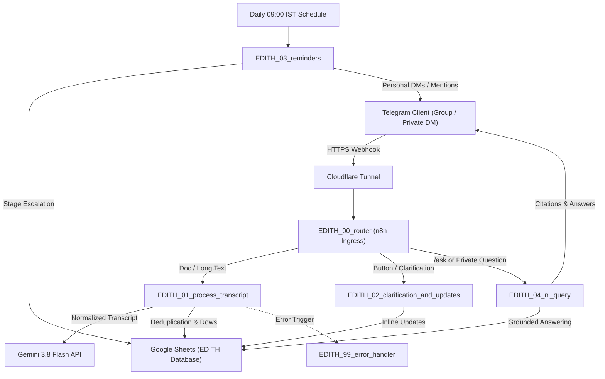

# EDITH - Efficient Digital Intelligence for Team Handling

> *"Turning Every Meeting into Measurable Action."*

**EDITH** is an autonomous, Telegram-first Chief-of-Staff agent designed for student hackathon teams, club committees, and software squads. Operating on a self-hosted **n8n** automation spine with **Google Gemini 3.8 Flash** structured reasoning and **Google Sheets** persistence, EDITH converts unstructured meeting discussions into verified, accountable deliverables.

---

## Architecture Overview



---

## Core Capabilities

1. **Deterministic Extraction & Zero-Hallucination**:
   - Spoken commitments (*"I will finish the backend"*) and agreed assignments (*"Priya, can you handle X?"*) are attributed strictly to their owners.
   - Unassigned tasks receive `owner: null` and `status: "unassigned"`.
   - Relative deadlines (*"Friday"*) are anchored deterministically against the meeting date in `Asia/Kolkata`.
2. **SHA-256 Pre-LLM Deduplication**:
   - Normalized transcript hashes halt duplicate uploads before consuming LLM tokens, preventing duplicate entries in Google Sheets.
3. **Self-Healing AI Repair Loop**:
   - Gemini outputs are validated against strict JSON schema invariants. If malformed, a repair loop retries up to 2 times before a graceful, friendly fallback.
4. **Interactive In-Chat Clarification**:
   - Ambiguous deadlines or missing assignees trigger immediate sub-64-byte inline keyboards (`act|TSK-XXXX|me`, `tomorrow`, `friday`) or free-text reply parsing.
5. **4-Stage Escalating Reminder Engine**:
   - Autonomous daily cron (09:00 AM IST) checks open tasks: **Stage 1 (T-2 days)** $\rightarrow$ **Stage 2 (T-1 day / Due tomorrow)** $\rightarrow$ **Stage 3 (Due today)** $\rightarrow$ **Stage 4 (Overdue)**.
   - Routes reminders directly to private DMs if the user is registered; otherwise `@mentions` in the team group.
   - Built-in anti-spam suppression ensures zero duplicate alerts on the same day.
6. **Cross-Meeting Sprint Memory**:
   - Remembers open tasks from the last 3 meetings. When a second meeting notes *"the frontend is done"*, EDITH marks the earlier task `completed` in Google Sheets instead of creating a duplicate action item.
7. **Grounded Natural Language Query Agent (`/ask`)**:
   - Answers team questions (*"What are my pending tasks?"*, *"Which tasks are overdue?"*, *"Is the frontend ready?"*) strictly from recorded sheet data, citing exact task IDs.

---

## Setup & Configuration Guide

### 1. Telegram Bot Setup (@BotFather)

1. Open Telegram and search for [@BotFather](https://t.me/botfather).
2. Create a new bot with `/newbot`:
   - **Name**: `EDITH`
   - **Username**: `edith_meeting_bot` (or any available unique username ending in `bot`).
   - Copy the **bot token** provided by BotFather.
3. Configure bot description and about text:
   - Send `/setdescription` -> Select your bot -> Enter:
     > EDITH: Turning Every Meeting into Measurable Action. Meeting-to-action agent for teams.
   - Send `/setabouttext` -> Select your bot -> Enter:
     > Chief-of-staff agent that turns meeting transcripts into tracked action items and follow-ups.
4. Configure the command menu:
   - Send `/setcommands` -> Select your bot -> Paste:
     ```text
     start - Wake EDITH and view operational status
     help - View detailed guide and submission instructions
     register - Link your Telegram ID to team database for direct reminders
     tasks - View personal assigned tasks, overdue items, or master board
     update - Update action item status (e.g. /update TSK-1001 completed)
     ask - Query meetings, decisions, and action items in natural language
     ```
5. **Disable Group Privacy Mode (CRITICAL)**:
   - Send `/setprivacy` to BotFather -> Select your bot -> Choose **Disable**.
   - BotFather will confirm: `Success! The new status is: DISABLED`.
6. Add EDITH to your team Telegram group as an **Administrator**.
7. Obtain your group `chat_id` (e.g. `-1001234567890`) via `@RawDataBot` or from the first n8n webhook execution.

---

### 2. Google Gemini API Setup

1. Visit [Google AI Studio](https://aistudio.google.com/).
2. Create an API key under your Google Cloud / AI Studio project.
3. Save the key for `.env` (`GEMINI_API_KEY`).
4. Default model: `gemini-3.8-flash` with low temperature (`0.1`).

---

### 3. Google Sheets Database Setup

1. Create a Google Spreadsheet named **"EDITH Database"**.
2. Create 5 tabs: `Meetings`, `ActionItems`, `OpenQuestions`, `Members`, and `Config`.
3. Import the header templates provided in `docs/csv/`:
   - `docs/csv/Meetings.csv` $\rightarrow$ `Meetings` tab
   - `docs/csv/ActionItems.csv` $\rightarrow$ `ActionItems` tab
   - `docs/csv/OpenQuestions.csv` $\rightarrow$ `OpenQuestions` tab
   - `docs/csv/Members.csv` $\rightarrow$ `Members` tab
   - `docs/csv/Config.csv` $\rightarrow$ `Config` tab
   *(See [docs/sheets_setup.md](docs/sheets_setup.md) for full column schemas).*
4. Copy your **Spreadsheet ID** from the browser URL:
   `https://docs.google.com/spreadsheets/d/<GOOGLE_SHEET_ID>/edit`
5. Configure Google Cloud OAuth:
   - In [Google Cloud Console](https://console.cloud.google.com/), enable **Google Sheets API** and **Google Drive API**.
   - In **APIs & Services > OAuth consent screen**, set user type to External and add your email as a test user.
   - In **APIs & Services > Credentials**, create an **OAuth client ID** (Web application).
   - Add Authorized redirect URI: `https://<YOUR_WEBHOOK_DOMAIN>/rest/oauth2-credential/callback`.

---

### 4. Cloudflare Tunnel & Docker Deployment

1. Copy the environment configuration template:
   ```bash
   cp .env.example .env
   ```
2. Populate `.env`:
   ```bash
   TELEGRAM_BOT_TOKEN="123456789:ABCdefGhIJKlmNoPQRstuVWXyz"
   GEMINI_API_KEY="AIzaSy..."
   GEMINI_MODEL="gemini-3.8-flash"
   WEBHOOK_URL="https://edith.yourdomain.com"
   GOOGLE_SHEET_ID="1BxiMVs0XRA5nFMdKvBdBZjgmUUqptlbs74OgvE2upms"
   GENERIC_TIMEZONE="Asia/Kolkata"
   ```
3. Start the containers:
   ```bash
   docker compose up -d
   ```
4. Access the n8n web interface at `http://localhost:5678`.

---

### 5. Workflow Credential Re-linking Steps (Fresh n8n Instance)

When importing workflows into a fresh n8n instance, re-link credentials in 3 quick steps:

1. **Google Sheets Credential**:
   - Go to **Credentials > Add Credential > Google Sheets OAuth2 API**.
   - Paste your Google Cloud OAuth **Client ID** and **Client Secret**.
   - Click **Connect my account** and complete authorization.
   - Name the credential `google_sheets_creds`.
2. **Telegram Bot Credential**:
   - Go to **Credentials > Add Credential > Telegram API**.
   - Paste your `TELEGRAM_BOT_TOKEN`.
   - Name the credential `telegram_bot_creds`.
3. **Workflow Import & Activation**:
   - Go to **Workflows > Import from File** and import all 6 workflows from `workflows/`:
     - `EDITH_00_router.json`
     - `EDITH_01_process_transcript.json`
     - `EDITH_02_clarification_and_updates.json`
     - `EDITH_03_reminders.json`
     - `EDITH_04_nl_query.json`
     - `EDITH_99_error_handler.json`
   - In each workflow, ensure Google Sheets and Telegram nodes reference your saved credentials.
   - Toggle all workflows to **Active**.

---

## Pre-Demo Checklist

Before starting your live presentation, verify these items:

- [ ] **Docker Containers Running**: `docker compose ps` shows `n8n` and `cloudflared` healthy.
- [ ] **Tunnel URL Reachable**: Accessing `WEBHOOK_URL` in browser reaches n8n.
- [ ] **Bot Privacy Disabled**: BotFather confirms `/setprivacy -> DISABLED`.
- [ ] **Google Sheets Prime**: `EDITH Database` contains the 5 tabs with empty rows except `Config` defaults.
- [ ] **Group Chat ID Set**: `Config` tab contains `group_chat_id = <your_group_id>`.
- [ ] **Self-Registration Done**: Presenter has sent `/register <Name>` in private DM to EDITH.
- [ ] **Sample Transcripts Ready**: Copies of `samples/01_hackathon_example.txt` and `samples/08_second_meeting_progress.txt` accessible on clipboard.

---

## 3-Minute Turnkey Demo Script

Follow this script step-by-step for a seamless live demonstration:

### [0:00 - 0:30] Step 1: Member Self-Registration
- **Action**: In private Telegram DM with `@edith_meeting_bot`, send:
  ```text
  /register Rahul Sharma
  ```
- **Expected Response**:
  > *"Registered. EDITH will now send your reminders directly."*
- **Judge Callout**: *"EDITH captures the private chat ID so reminders are routed directly to personal DMs instead of cluttering group channels."*

### [0:30 - 1:15] Step 2: First Meeting Analysis & Zero Hallucination
- **Action**: In your team group, paste the contents of `samples/01_hackathon_example.txt`:
  ```text
  Meeting: Hackathon Kickoff
  Date: 2026-11-09

  Rahul: I will finish prompt engineering and response schema by Wednesday, Nov 11.
  Priya: I will build the Telegram bot router in n8n by Thursday, Nov 12.
  Rahul: Someone needs to write the project documentation and setup guide.
  ```
- **Expected Response**:
  > **EDITH MEETING REPORT**
  > **Title:** Hackathon Project Kickoff & Task Allocation
  > **Date:** Mon, 9 Nov 2026
  > 
  > **Action Items (3 logged):**
  > 1. 📌 **Finish prompt engineering and response schema** — @rahul_dev | 📅 Wed, 11 Nov 2026 | Status: `assigned`
  > 2. 📌 **Build the Telegram bot router in n8n** — @priya_p | 📅 Thu, 12 Nov 2026 | Status: `assigned`
  > 3. ⚠️ **Write project documentation and setup guide** — *Unassigned* | 📅 *No deadline* | Status: `unassigned`
  > 
  > **Clarifications Required:**
  > • ⚠️ **Write project documentation and setup guide** (TSK-XXXX) — Owner unassigned
- **Follow-up Message**: EDITH dispatches an interactive message with inline buttons:
  > `[ Assign to me ]` `[ Rahul Sharma ]` `[ Skip ]`
- **Judge Callout**: *"Notice zero hallucination: EDITH did not invent an owner for documentation. Instead, it flagged it and surfaced an interactive button right in chat."*

### [1:15 - 1:45] Step 3: Interactive In-Chat Clarification
- **Action**: Click the **[ Assign to me ]** button on the clarification message.
- **Expected Response**: EDITH updates the message:
  > *"Clarification Recorded: TSK-XXXX updated to assigned (Assignee: @rahul_dev)."*
- **Judge Callout**: *"One-tap human-in-the-loop resolution without leaving Telegram. The row in Google Sheets is updated in real time."*

### [1:45 - 2:15] Step 4: Proactive Reminders & Progress Tracking
- **Action**: In n8n, trigger `EDITH_03_reminders` manually (or demonstrate the scheduled execution).
- **Expected Response**: Presenter receives a private Telegram DM:
  > *"Rahul Sharma, your 'Finish prompt engineering and response schema' deadline is tomorrow. Current progress?"*
  > `[ Done ]` `[ In progress ]` `[ Need more time ]`
- **Action**: Tap **[ Done ]**.
- **Expected Response**:
  > *"Task Updated: TSK-XXXX — Status set to `completed`."*
- **Judge Callout**: *"Automated 4-stage escalation with anti-spam suppression. A simple tap on 'Done' updates our database instantly."*

### [2:15 - 2:45] Step 5: Cross-Meeting Sprint Memory & Deduplication
- **Action**: Paste `samples/08_second_meeting_progress.txt` into the group:
  ```text
  Meeting: Hackathon Standup & Backend Kickoff
  Date: 2026-11-12

  Rahul: Good morning team. Quick update from my side: the frontend is done. We wrapped up all responsive screens and styling yesterday.
  Priya: Fantastic work Rahul. Now that frontend is finished, can you integrate the Stripe payment API by Friday?
  Rahul: Yes, I will integrate the Stripe payment API by this Friday, November 13.
  Priya: Great. I will write the deployment documentation by Saturday, November 14.
  ```
- **Expected Response**:
  > **EDITH MEETING REPORT**
  > **Updates to earlier tasks:**
  > • ✅ `TSK-1001` — Marked `completed` *("the frontend is done")*
  > 
  > **Action Items (2 logged):**
  > 1. 📌 **Integrate the Stripe payment API** — @rahul_dev | 📅 Fri, 13 Nov 2026
  > 2. 📌 **Write the deployment documentation** — @priya_p | 📅 Sat, 14 Nov 2026
- **Judge Callout**: *"EDITH maintains memory of prior meetings. When Rahul announced the frontend was done, EDITH marked the earlier task completed and created ZERO duplicates."*

### [2:45 - 3:00] Step 6: Grounded Natural Language Query
- **Action**: In private chat or group, send:
  ```text
  /ask Is the frontend ready?
  ```
- **Expected Response**:
  > *"Yes, the frontend is ready. All related tasks ([TSK-1001]) are marked `completed`."*
- **Action**: Check overdue tasks:
  ```text
  /tasks
  ```
- **Expected Response**: Formatted list of your currently pending action items.

---

## Known Limitations

1. **File Format**: Supports plain text (`.txt`) and pasted text. Audio recordings and PDFs must be transcribed to plain text before submission.
2. **File Size Limit**: Transcripts capped at 200 KB (~50,000 words), well above standard meeting transcript lengths.
3. **Telegram Message Length**: Telegram imposes a 4,096-character limit per message. EDITH automatically slices longer reports cleanly across section boundaries (`\n\n`).
4. **DM Initiation Restriction**: By Telegram Bot API design, bots cannot initiate private DMs to users who have never spoken to the bot. Users must send `/register <Name>` or `/start` in DM once to enable direct follow-ups.

---

## Troubleshooting Guide

### 1. Telegram Webhook Not Firing
- **Symptom**: Messages sent to the bot in Telegram generate no execution in n8n.
- **Remedy**:
  1. Verify the `cloudflared` container is up: `docker compose logs cloudflared`.
  2. Verify that `WEBHOOK_URL` in `.env` matches your Cloudflare tunnel domain.
  3. Ensure the workflow `EDITH_00_router` is toggled to **Active**.
  4. Test the webhook manually:
     ```bash
     curl -i https://<YOUR_WEBHOOK_URL>/webhook/telegram-trigger-001
     ```

### 2. Google Gemini API 429 Rate Limits / 5xx Errors
- **Symptom**: Execution fails on `Call Gemini generateContent`.
- **Remedy**:
  1. All HTTP Request nodes calling Gemini have `retryOnFail: true`, `maxTries: 3`, and a 2000 ms backoff.
  2. If using the free tier of Google AI Studio, ensure requests do not exceed 15 RPM.
  3. Verify `GEMINI_API_KEY` is active and billed or has quota remaining in Google AI Studio.

### 3. Google Sheets Permission or OAuth 403 Errors
- **Symptom**: Node reports `The caller does not have permission` or `invalid_grant`.
- **Remedy**:
  1. Ensure your Google Spreadsheet is shared with the Google Account authenticated in n8n.
  2. Verify that the Google Cloud OAuth Consent Screen is published or that your Google email is added as a **Test User**.
  3. Ensure both `Google Sheets API` and `Google Drive API` are enabled in Google Cloud Console.

---

## Test Suite & Verification Matrix

The automated test suite verifies all 32 operational scenarios:
```bash
node tests/run_all_tests.js
```
```text
================================================================
RUNNING EDITH MASTER ACCEPTANCE TEST SUITE
================================================================

[PASS] TC-01 to TC-32 (100.0% Pass Rate)
Updated tests/test_cases.md successfully! Pass Rate: 100.0% (32/32)
```
See [`tests/test_cases.md`](tests/test_cases.md) for the complete scenario matrix.
